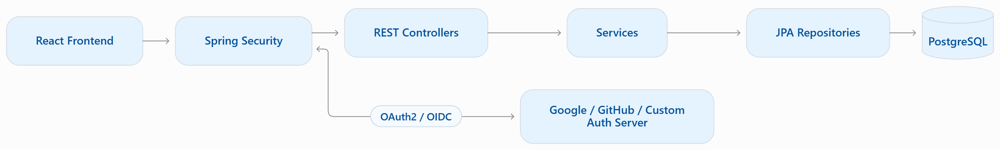
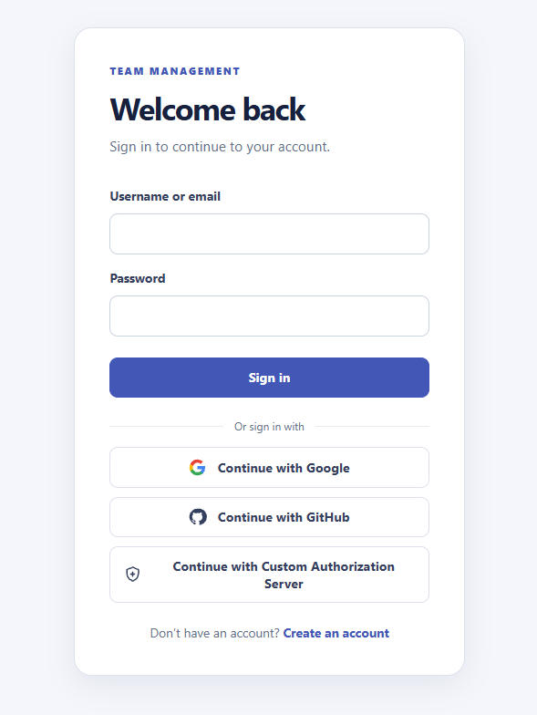
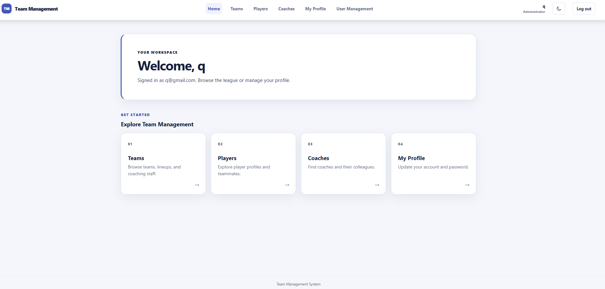
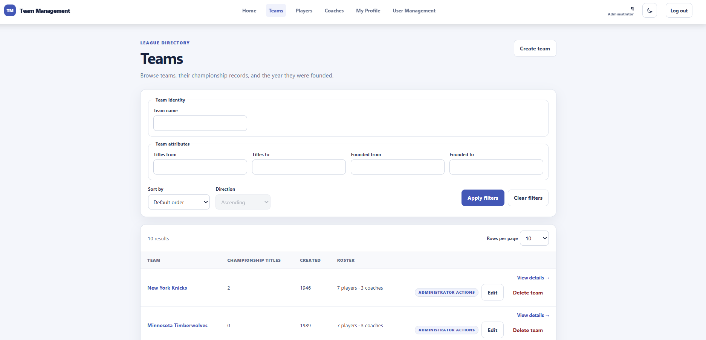
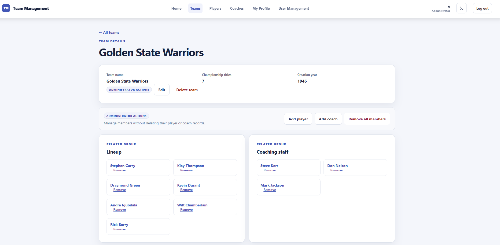
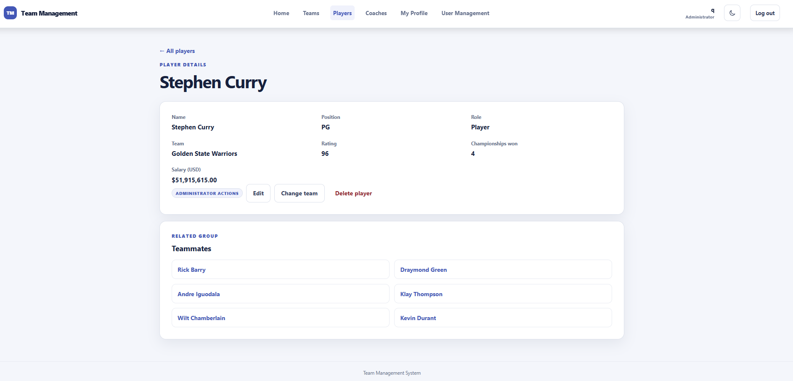
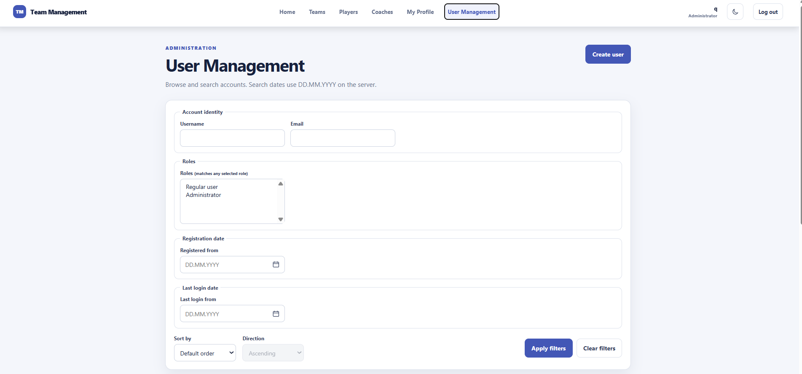
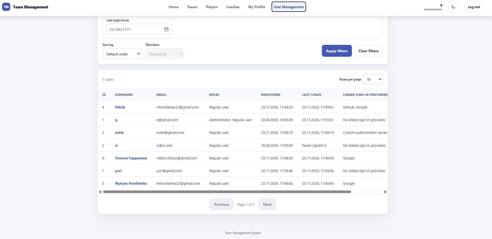
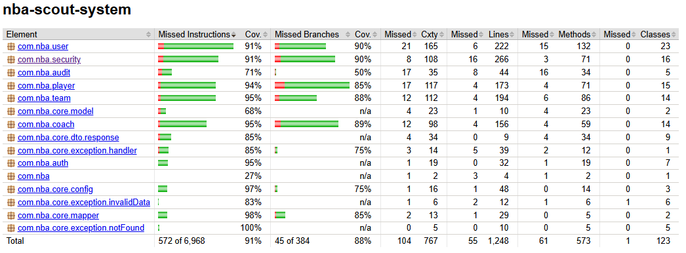

# Team Management System


A full-stack application for managing professional basketball teams, players, coaches, and users. It provides role-based access control, team roster and transfer management, dynamic search, and OAuth2/OIDC authentication.

Built with **Java, Spring Boot, React, TypeScript, and PostgreSQL**, the backend combines layered domain modules, **Spring Data JPA Specifications**, **Liquibase** schema migrations, **Spring AOP** audit logging, and **Testcontainers** integration tests.

## Demo
https://github.com/user-attachments/assets/f2bbe93e-f19c-4018-8ddf-01dcf4200b04

## Features

- **Teams, Rosters & Transfers:** Create, update, and delete teams, view rosters and coaching staff, and manage player and coach transfers. Players and coaches can be queried both independently and through their teams.
- **Players & Coaches:** Manage profiles, positions, experience, ratings, championships, and USD salaries.
- **Role-Based Access Control (RBAC):** Separate Admin and User permissions. Admins manage all sports entities, transfers, and user accounts (including registration dates, last login, and linked sign-in providers); regular users have read access to sports data and manage their own profiles.
- **OAuth2 / OIDC Authentication:** Sign in with form login, **Google**, **GitHub**, or a [Custom Authorization Server](https://github.com/nhordiienko23/MyCustomAuthServer), with verified external account linking.
- **Dynamic Search & Pagination:** Server-side filtering via Spring Data JPA Specifications and `Pageable`, synced with browser URL parameters for bookmarking and history navigation (including multi-select OR filtering by player position).
- **Audit Logging & Error Handling:** Centralized action auditing using Spring AOP and consistent API error responses via `@ControllerAdvice`.
- **Frontend Experience:** Dark mode by default with persistent light/dark theme switching, inline form validation, and same-origin Vite proxy integration.

## Technology Stack

| Area | Technologies |
| --- | --- |
| Backend | Java 21, Spring Boot 3, Spring Web MVC, Spring Data JPA, Hibernate, Spring AOP, Liquibase |
| Security | Spring Security, OAuth2 Client, OpenID Connect (OIDC), HttpOnly / SameSite=Lax Sessions |
| Frontend | React, TypeScript, Vite |
| Database | PostgreSQL 16 |
| API Documentation | Springdoc OpenAPI, Swagger UI |
| Testing & Coverage | JUnit 5, Mockito, Spring Boot Test, Spring Security Test, Testcontainers, JaCoCo |
| Infrastructure & Build | Docker, Docker Compose, Maven, npm |

## Architecture


### Backend Structure & Layers

The backend is organized by domain (`team`, `player`, `coach`, `user`, `auth`, `audit`, `security`) across standard MVC layers:

- **Controllers:** Handle HTTP requests, validation, pagination, and OpenAPI contracts.
- **Services & Mappers:** Encapsulate business rules, roster transfers, transaction boundaries, and Entity-to-DTO mapping.
- **Repositories & Specifications:** Execute persistence operations and build dynamic multi-criteria SQL queries.
- **Security & Audit:** Manage OAuth2/OIDC flows, external identity linking, RBAC policies, and AOP-based audit logging.

### Key Engineering Highlights

- **Hardened OAuth2 / OIDC Account Linking:** External accounts bind to stable provider identifiers (OIDC `issuer` + `subject`, or GitHub numeric ID). First-time linking requires a trusted verified email (`email_verified: true` for configured OIDC issuers, or a primary verified email from GitHub's authenticated `/user/emails` API) — public profile and synthetic emails are never trusted.
- **Dynamic Filtering Without Boilerplate Queries:** Uses Spring Data JPA `Specification` combined with `Pageable` to support flexible combinations of salary, experience, rating, championship, and multi-position filters in a single endpoint.
- **Strict Database Schema Governance:** Liquibase manages all versioned migrations automatically on startup while Hibernate runs with `ddl-auto: validate`, preventing unintended schema drift.
- **Real-Database Integration Testing:** Full controller, service, and repository test suites run against real PostgreSQL containers via Testcontainers, validating security rules, transactions, and queries end-to-end.

## Getting Started

### Prerequisites

- **Java 21** and **Maven**
- **Node.js** and **npm**
- **Docker** with **Docker Compose** (or a local PostgreSQL 16 instance)
- OAuth2 client credentials for the providers you want to test

### 1. Start PostgreSQL

Docker Compose provisions the PostgreSQL database for local development (backend and frontend run separately):

```bash
docker compose up -d db
```

### 2. Configure environment variables

Set OAuth and database variables in your shell or IDE run configuration (never commit secrets to source files or frontend `.env` files):

| Variable | Default / Notes | Purpose |
| --- | --- | --- |
| `SPRING_DATASOURCE_URL` | Local Compose DB | PostgreSQL JDBC URL |
| `SPRING_DATASOURCE_USERNAME`, `SPRING_DATASOURCE_PASSWORD` | Local dev defaults | PostgreSQL credentials |
| `GOOGLE_CLIENTID`, `GOOGLE_SECRET` | — | Google OAuth2 credentials |
| `GITHUB_CLIENTID`, `GITHUB_SECRET` | — | GitHub OAuth2 credentials |
| `CUSTOM_AUTH_CLIENTID`, `CUSTOM_AUTH_SECRET` | — | Custom auth server credentials |
| `CUSTOM_AUTH_ISSUER_URI` | `http://localhost:9000` | Custom OIDC issuer URI |
| `CUSTOM_AUTH_AUTHORIZATION_URI`, `CUSTOM_AUTH_TOKEN_URI`, `CUSTOM_AUTH_USER_INFO_URI`, `CUSTOM_AUTH_JWK_SET_URI` | `http://localhost:9000/...` | Custom OIDC provider endpoints |
| `TRUSTED_OIDC_ISSUERS` | `https://accounts.google.com` | Comma-separated OIDC issuers trusted for `email_verified: true` |
| `GITHUB_EMAIL_URI` | `https://api.github.com/user/emails` | GitHub verified email API endpoint |
| `SESSION_COOKIE_SECURE` | `true` | Set to `false` only for local HTTP development |
| `FRONTEND_ORIGIN` | `http://localhost:5173` | Redirect origin after sign-in / logout |

### 3. Start the backend

From the repository root:

```bash
mvn spring-boot:run
```

The API starts at `http://localhost:8080` and automatically applies Liquibase migrations.

### 4. Start the frontend

In a second terminal:

```bash
cd frontend
npm install
npm run dev
```

Open **[http://localhost:5173](http://localhost:5173)**. The Vite dev server proxies `/api/**`, `/login`, `/oauth2/**`, `/logout`, and Swagger requests to `http://localhost:8080`.

### Local URLs

| Component | URL |
| --- | --- |
| Frontend (Vite) | `http://localhost:5173` |
| Backend API | `http://localhost:8080` |
| Swagger UI | `http://localhost:8080/swagger-ui.html` (or via `:5173/swagger-ui.html`) |
| OpenAPI Spec | `http://localhost:8080/v3/api-docs` |

## OAuth2 / OIDC Callback Setup

Register these callback URLs with your OAuth providers when running through the Vite dev server (use your public HTTPS origin in production):

| Provider | Development Callback URL |
| --- | --- |
| Google | `http://localhost:5173/login/oauth2/code/google` |
| GitHub | `http://localhost:5173/login/oauth2/code/github` |
| Custom Auth Server | `http://localhost:5173/login/oauth2/code/my-custom-auth` |

<details>
<summary>Production deployment checklist</summary>

- Serve `frontend/dist` and proxy backend routes (`/api/**`, `/login`, `/login/oauth2/**`, `/oauth2/authorization/**`, `/logout`, `/swagger-ui/**`, `/v3/api-docs/**`, `/error`) from the same public HTTPS origin before SPA fallback.
- Keep `SESSION_COOKIE_SECURE=true` and configure trusted reverse-proxy forwarded headers.
- Replace all local DB credentials, callback URLs, and custom OIDC endpoints (`localhost:9000`) with production values.

</details>

## Testing & Code Coverage

### Backend

The test suite includes unit tests (Mockito) for business logic, mappers, validation, and specifications, plus **Testcontainers** integration tests for controllers, services, repositories, and security flows against PostgreSQL (requires Docker running).

Run all tests and generate the JaCoCo coverage report from the repository root:

```bash
mvn clean verify
```

| Metric | Covered | Total | Coverage |
| --- | ---: | ---: | ---: |
| Instructions | 6,396 | 6,968 | **91%** |
| Branches | 339 | 384 | **88%** |
| Lines | 1,193 | 1,248 | **96%** |
| Methods | 512 | 573 | **89%** |
| Classes | 122 | 123 | **99%** |

- HTML coverage report: `target/site/jacoco/index.html`
- XML coverage report: `target/site/jacoco/jacoco.xml`

### Frontend

From the `frontend` directory:

```bash
npm run typecheck
npm run build
```

The production bundle is generated in `frontend/dist`.

## Project Structure

```text
team-management-system/
├── src/
│   ├── main/
│   │   ├── java/.../         # Domain packages: team, player, coach, user, auth, audit, security
│   │   └── resources/        # application.yml & Liquibase changelogs
│   └── test/                 # Unit tests & Testcontainers integration tests
├── frontend/                 # React + TypeScript + Vite SPA
├── docs/                     # Architecture diagram, UI screenshots, and coverage report
├── docker-compose.yml        # PostgreSQL 16 database for local development
└── pom.xml                   # Maven configuration, dependencies, JaCoCo setup
```

## Screenshots


### Sign In (Form & OAuth2 / OIDC)


### Home Page

### Teams Directory & Dynamic Filtering


### Team Roster & Coaching Staff


### Player Details & Teammates


### Admin User Management & Linked Providers


### JaCoCo Coverage Report


## Author

**Mykyta Hordiienko** — [GitHub](https://github.com/nhordiienko23)